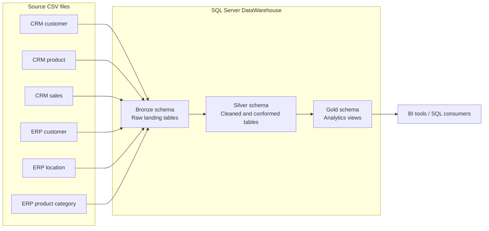

# DataWarehouse — SQL Server Medallion Warehouse

A data-engineering project that consolidates sales, customer, product, and reference data from CRM- and ERP-style CSV sources into an analytics-ready SQL Server warehouse. The implementation uses a **Bronze → Silver → Gold** medallion flow, T-SQL stored procedures for repeatable full-refresh loads, and dimensional views for downstream reporting.

## Project at a glance

- **Platform:** Microsoft SQL Server
- **Language:** T-SQL
- **Architecture:** Medallion (Bronze / Silver / Gold)
- **Sources:** Six CSV files from CRM and ERP domains
- **Gold data model:** Customer and product dimensions plus a sales fact view
- **Primary use:** A clean, integrated relational layer for BI, reporting, and SQL analysis

## Architecture



### Layer responsibilities

| Layer | Purpose | Implementation |
|---|---|---|
| **Bronze** | Land source records with minimal transformation and retain source-oriented columns. | Six typed tables loaded by `bronze.load_bronze` using `BULK INSERT`. |
| **Silver** | Clean, standardize, validate, and align CRM and ERP attributes. | Six curated tables populated by `silver.load_silver`. |
| **Gold** | Present business-friendly dimensions and a fact view for analytical use. | Views: `gold.dim_customers`, `gold.dim_products`, and `gold.fact_sales`. |

## Source data

The `Datasets/` directory contains:

| Domain | File | Contents |
|---|---|---|
| CRM | `source_crm/cust_info.csv` | Customer identifiers, names, marital status, gender, and creation date |
| CRM | `source_crm/prd_info.csv` | Product identifiers, names, costs, product lines, and effective dates |
| CRM | `source_crm/sales_details.csv` | Order, customer, product, date, quantity, sales, and price fields |
| ERP | `source_erp/CUST_AZ12.csv` | Customer birth date and gender attributes |
| ERP | `source_erp/LOC_A101.csv` | Customer country/location attributes |
| ERP | `source_erp/PX_CAT_G1V2.csv` | Product category, subcategory, and maintenance attributes |

## Data processing and modeling

### Bronze ingestion

`bronze.load_bronze` truncates and reloads each Bronze table from its corresponding CSV. It skips the header row and reports the start time, end time, and elapsed seconds. The procedure includes `TRY...CATCH` error reporting.

### Silver transformations

`silver.load_silver` applies domain-specific cleanup and conformance, including:

- Trims customer names and normalizes marital status, gender, and product-line codes into readable values; keeps the latest customer record per customer ID and filters null customer IDs.
- Standardizes ERP customer IDs by removing the `NAS` prefix and aligns ERP location IDs by removing hyphens, allowing cross-source customer joins.
- Maps country abbreviations such as `DE`, `US`, and `USA` to readable country names; converts blank or missing country values to `n/a`.
- Derives product category IDs and product keys from the CRM product key; replaces missing product cost with zero; derives product end dates using the next effective start date per product key.
- Converts eight-digit sales date values to SQL dates and maps zero or malformed-length dates to `NULL`.
- Reconciles sales and price values using quantity, absolute price, and available sales values; protects the price fallback from division by zero with `NULLIF`.
- Adds a `dwh_create_date` default to Silver tables to record when rows are loaded.

### Gold dimensional model

The Gold layer exposes three views:

- **`gold.dim_customers`** — Customer attributes enriched with country, birth date, and ERP gender as a fallback when CRM gender is unavailable.
- **`gold.dim_products`** — Current product versions enriched with category and subcategory metadata; products with a non-null end date are excluded.
- **`gold.fact_sales`** — Sales measures and dates, joined to the customer and product dimensions to expose their generated surrogate keys.

Customer and product surrogate keys are generated with `ROW_NUMBER()` in the views. The sales view uses `LEFT JOIN`s so sales records remain present even when a dimension lookup does not find a match.

## Repository structure

```text
DataWarehouse/
├── Datasets/
│   ├── source_crm/
│   └── source_erp/
├── Scripts/
│   ├── init_database_and_schemas.sql
│   ├── bronze_layer/
│   │   ├── DDL_bronze.sql
│   │   └── Bronze_Layer_script.sql
│   ├── silver_layer/
│   │   ├── DDL_silver.sql
│   │   └── Silver_Layer_Script.sql
│   └── gold_layer/
│       └── Gold_Layer_Script.sql
└── README.md
```

## Set up and run

### Prerequisites

- Microsoft SQL Server and a SQL client such as SQL Server Management Studio (SSMS).
- Permission to create the `DataWarehouse` database and schemas.
- SQL Server's Database Engine service account must be able to read the CSV files for `BULK INSERT`.

### Execution order

Run the scripts in SSMS in this order, using the same SQL Server instance:

1. `Scripts/init_database_and_schemas.sql` — creates the database and the Bronze, Silver, and Gold schemas if they do not exist.
2. `Scripts/bronze_layer/DDL_bronze.sql` — creates the Bronze tables.
3. `Scripts/silver_layer/DDL_silver.sql` — creates the Silver tables.
4. `Scripts/bronze_layer/Bronze_Layer_script.sql` — creates the Bronze load procedure. Then execute `EXEC bronze.load_bronze;` in the `DataWarehouse` database.
5. `Scripts/silver_layer/Silver_Layer_Script.sql` — creates the Silver load procedure. Then execute `EXEC silver.load_silver;` in the `DataWarehouse` database.
6. `Scripts/gold_layer/Gold_Layer_Script.sql` — creates the Gold views.

### Configure the CSV location

The current Bronze load procedure uses absolute Windows file paths under `D:\Data Analytics\_Projects\DataWarehouse\Datasets`. After cloning, update each `BULK INSERT` path in `Scripts/bronze_layer/Bronze_Layer_script.sql` to the local location of the six CSVs. The paths must be accessible to the **SQL Server service account**, not only to the interactive user running SSMS.

## Operational notes

- The load procedures implement **full refreshes**: they truncate the target tables before loading or transforming data. Re-running them replaces the existing layer contents rather than applying incremental changes.
- The DDL scripts use `DROP TABLE IF EXISTS` (and the Gold script drops/recreates views). Review this behavior before running against any database containing data you need to preserve.
- Load duration and error details are printed to the SQL client. These procedures are intended as a straightforward local portfolio workflow, not a production orchestration framework.
- Gold surrogate keys are generated at query time with `ROW_NUMBER()`; they are not persisted identifiers and may change if the underlying dimension rows or sort order change.
